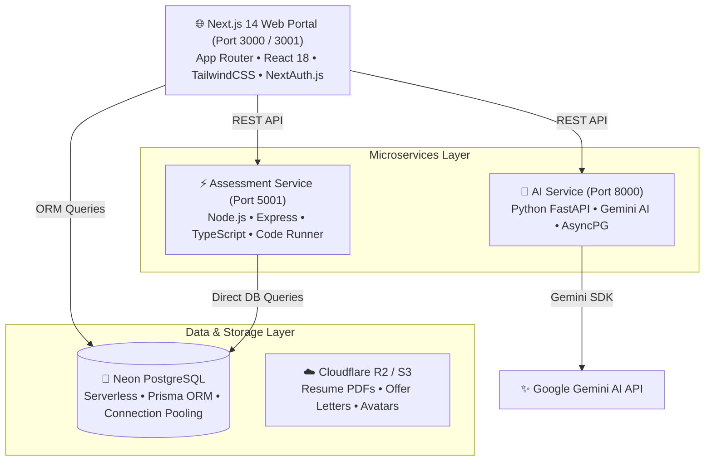

<div align="center">

# 🎓 PlacementHub
### The Enterprise Campus Placement & Career Operating System

[](https://nextjs.org/)
[](https://react.dev/)
[](https://www.typescriptlang.org/)
[](https://www.prisma.io/)
[](https://neon.tech/)
[](https://fastapi.tiangolo.com/)
[](https://tailwindcss.com/)
[](LICENSE)

<p align="center">
  <strong>PlacementHub</strong> transforms fragmented college campus recruitment into a unified, intelligent, and verifiable career operating system. Connecting <strong>students, placement cells (TPOs), recruiters, faculty mentors, institute leaders, and alumni</strong> under a single source of truth powered by <strong>Google Gemini AI</strong> and <strong>serverless PostgreSQL</strong>.
</p>

[Explore Features](#-key-stakeholder-modules) •
[Architecture](#-system-architecture) •
[Quick Start](#-quick-start) •
[Demo Credentials](#-pre-configured-demo-credentials) •
[Author & Contact](#-author--contact)

---

</div>

## 📌 Executive Summary

Higher education institutions frequently navigate campus placements through disconnected spreadsheets, informal WhatsApp groups, unverified student claims, and cumbersome accreditation reporting.

**PlacementHub** delivers an enterprise-grade monorepo platform that unifies and automates the complete campus recruitment lifecycle:
* **7 Tailored Role Portals**: Dedicated workspaces for Student, TPO, Recruiter, Faculty Mentor, Alumni, Institute Admin, and Super Admin.
* **AI-Powered Career Intelligence**: Automated ATS resume scoring (0–100), AI STAR-method mock interview feedback, and proctored coding assessments.
* **Anti-Fraud Security**: Integrated fake job posting detector to protect students from predatory recruitment scams.
* **Compliance & Accreditation Automation**: 1-click NAAC Criterion 5.2.1, NBA, and NIRF placement telemetry reporting.
* **Verified Talent Passport™**: Tamper-proof public digital portfolio displaying verified GitHub repositories, live project URLs, and coding benchmark badges.

---

## 🏗️ System Architecture

PlacementHub is architected as a clean, modular production monorepo:



### Monorepo Structure

```
PlacementHub/
├── apps/
│   └── web/                   # Next.js 14 Full-Stack Enterprise Portal
│       ├── prisma/            # Schema definition, migrations & seed scripts
│       ├── public/            # Static media, icons & brand assets
│       └── src/
│           ├── app/           # App Router pages (/student, /tpo, /recruiter, etc.)
│           ├── components/    # Reusable UI component design system
│           ├── contexts/      # React contexts (Theme, Auth, Telemetry)
│           └── lib/           # Prisma client, AI helpers, ATS evaluators
│
├── services/
│   ├── assessment/            # Code Evaluation & Assessment Microservice
│   │   ├── src/               # Express endpoints, test-case runners, scoring
│   │   └── package.json       # Node.js dependencies
│   └── ai/                    # Python FastAPI AI Microservice
│       ├── app/               # FastAPI endpoints, Gemini client, heuristics
│       └── pyproject.toml     # Python dependencies
│
├── docs/                      # Architectural Documentation & Runbooks
│   ├── env.md                 # Complete environment variables guide
│   └── product-spec.md        # Technical product specification & roles
│
└── scripts/                   # Operations & Testing Utilities
    ├── start-services.ps1     # 1-Click launcher for all microservices
    ├── verify_production.js   # Automated production health verification
    └── comprehensive_test_suite.py # End-to-end integration test suite
```

---

## 👥 Key Stakeholder Modules

| Role | Portal Path | Key Features |
| :--- | :--- | :--- |
| **👨‍🎓 Student** | `/student` | • **Talent Passport™** with verified public slug<br/>• **ATS Resume Studio** with real-time scoring (0–100)<br/>• **Campus & Off-Campus Drives** with 1-click eligibility check<br/>• **Interactive Coding Arena** for DSA practice<br/>• **AI Mock Interview Coach** with STAR feedback<br/>• **Alumni Mentorship** booking |
| **🏫 TPO (Placement Cell)** | `/tpo` | • **Placement Drive Manager** (On-Campus, Off-Campus, Pooled)<br/>• **Automated Eligibility Engine** (CGPA cutoffs, backlogs)<br/>• **NAAC / NBA / NIRF Reports** generated in one click<br/>• **Kanban Stage Progression** (Applied → OA → Interview → Offered)<br/>• **Broadcast Announcements** via Email & SMS |
| **🏢 Recruiter** | `/recruiter` | • **Candidate Discovery** with multi-parameter filtering<br/>• **Drag-and-Drop ATS Kanban Board**<br/>• **Google Meet Interview Scheduler** with scoring rubrics<br/>• **Digital Offer Letter Dispatch** & acceptance telemetry |
| **👨‍🏫 Faculty Mentor** | `/faculty` | • **Cohort Health Dashboard** tracking placed vs. unplaced students<br/>• **Department Resource Library** (DSA guides, core notes)<br/>• **Academic Advisories** & mentorship logs |
| **👨‍💼 Alumni Network** | `/alumni` | • **1:1 Video Mentorship Slot Booking**<br/>• **Verified Company Job Referrals** portal<br/>• **Company-Specific Interview Archives** & tips |
| **🏛️ Institute Admin** | `/institute` | • **Campus Governance** (Branches, student capacity, NIRF rank)<br/>• **Placement Policy Automation** (Dream Company rules e.g. ≥ ₹12 LPA)<br/>• **Multi-Stakeholder Account Directory** |
| **⚙️ Super Admin** | `/super-admin` | • **Multi-Tenant SaaS Overview** across onboarded universities<br/>• **Global Off-Campus Drive Syndication**<br/>• **SaaS Tier Management & Revenue Analytics**<br/>• **Live Telemetry** for Neon DB, AI engines & API health |

---

## 🚀 Quick Start

### 1. Prerequisites
- **Node.js**: `v18.0.0` or higher (Recommended: `v20+`)
- **Python**: `3.10+` (for AI microservice)
- **PostgreSQL**: Neon Serverless PostgreSQL or local PostgreSQL instance
- **Git**

### 2. Clone Repository
```bash
git clone https://github.com/vyankateshbairagi/PlacementHub.git
cd PlacementHub
```

### 3. Setup Environment Variables
Refer to [`docs/env.md`](./docs/env.md) for detailed configuration.

```bash
# Web Application
cp apps/web/.env.example apps/web/.env

# Assessment Service
cp services/assessment/.env.example services/assessment/.env

# AI Service
cp services/ai/.env.example services/ai/.env
```

Ensure your `DATABASE_URL` in `apps/web/.env` and `services/assessment/.env` points to your Neon PostgreSQL database:
```env
DATABASE_URL="postgresql://<user>:<password>@<host>/<database>?sslmode=require"
NEXTAUTH_SECRET="your-generated-secret"
GEMINI_API_KEY="your-gemini-api-key"
```

### 4. Database Schema & Seeding
```bash
cd apps/web
npm install
npx prisma db push
npm run db:seed
```

### 5. Launch All Services

#### Option A: 1-Click PowerShell Script (Windows)
```powershell
.\scripts\start-services.ps1
```

#### Option B: Manual Terminal Execution
```bash
# Terminal 1: Web Application (Port 3000 / 3001)
cd apps/web
npm run dev

# Terminal 2: Assessment Microservice (Port 5001)
cd services/assessment
npm run dev

# Terminal 3: AI Microservice (Port 8000)
cd services/ai
pip install -r requirements.txt
uvicorn app.main:app --port 8000 --reload
```

Open [http://localhost:3000](http://localhost:3000) (or `http://localhost:3001`) in your browser.

---

## 🔑 Pre-Configured Demo Credentials

Use any of these pre-seeded institutional accounts to explore specific role consoles:

| Stakeholder Role | Email Address | Password | Default Portal Route |
| :--- | :--- | :--- | :--- |
| **Super Admin** | `admin@placementhub.in` | `Admin@123` | `/super-admin` |
| **TPO Officer** | `tpo@gcoen.ac.in` | `Tpo@123` | `/tpo` |
| **Student** | `aditya.shinde@student.gcoen.ac.in` | `Student@123` | `/student` |
| **Recruiter (Google)** | `recruiter.google@placementhub.org` | `Recruiter@123` | `/recruiter` |
| **Faculty Mentor** | `faculty.cs@gcoen.ac.in` | `Faculty@123` | `/faculty` |
| **Alumni Mentor (Microsoft)**| `alumni.microsoft@placementhub.org` | `Alumni@123` | `/alumni` |
| **Institute Admin (Principal)**| `principal@gcoen.ac.in` | `Principal@123` | `/institute` |

> 💡 **Quick Switcher**: The development navbar contains an intuitive 1-click Role Switcher allowing instant toggling across roles without manual re-login.

---

## 🔒 Security & Data Integrity

- **Zero-Secret Repository**: All database passwords, API tokens, and session secrets are managed strictly through gitignored environment variables.
- **Enterprise RBAC**: NextAuth.js JWT middleware validates role permissions on every protected API route and dashboard view.
- **Audited Mock Credentials**: All mock recruiter and alumni domains use safe internal namespaces (`@placementhub.org`) to protect third-party identities and prevent credential exposure.
- **Production SSL**: Database connections enforce `sslmode=require` across all Prisma and AsyncPG connection pools.

---

## 👨‍💻 Author & Contact

**PlacementHub** is designed, architected, and maintained by:

### **Vyankatesh Bairagi**
*Full-Stack Engineer & System Architect*

- 📱 **Mobile / WhatsApp**: [+91 9075097235](tel:+919075097235)
- 📧 **Email**: [vyankateshbairagi.dev@gmail.com](mailto:vyankateshbairagi.dev@gmail.com)
- 🐙 **GitHub**: [@vyankateshbairagi](https://github.com/vyankateshbairagi)
- 🌐 **Project Repository**: [https://github.com/vyankateshbairagi/PlacementHub](https://github.com/vyankateshbairagi/PlacementHub)

---

## 📄 License

This project is licensed under the [MIT License](LICENSE) - see the LICENSE file for details.

<div align="center">
  <sub>Built with ❤️ for colleges and students across India. © 2026 PlacementHub.</sub>
</div>